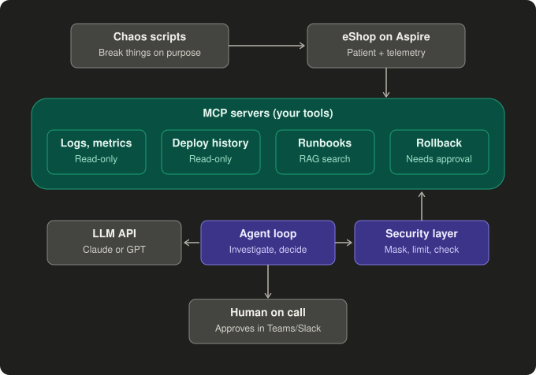

# AI On-Call Developer

An AI on-call developer that diagnoses production incidents and acts only with human approval.

Built in .NET to learn agentic AI and AI security hands-on: MCP tools, RAG over runbooks,
human-in-the-loop actions, evals and red-teaming.

