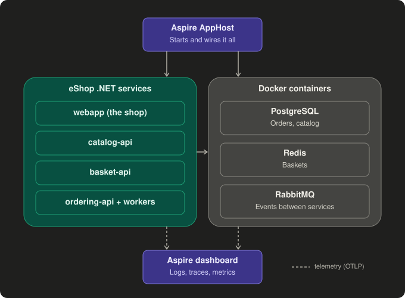

# Aspire, Docker and OpenTelemetry

*As of: 2026-11-11*

## Concepts

- **eShop:** Microsoft's sample shop, built from several small .NET services
  (webapp, catalog, basket, ordering). In this project it's the "patient" the agent looks after.
- **Docker container:** a sealed box with a program plus everything it needs, so it runs
  the same on any machine. Here it runs PostgreSQL, Redis and RabbitMQ.
- **Aspire AppHost:** one C# file that describes all services and their dependencies.
  `aspire run` starts everything in order and gives each service its connection strings.
- **Aspire dashboard:** shows logs, traces and metrics from all services in one place.
  Data lives in memory only and is gone after stopping.
- **OpenTelemetry (OTel):** the standard way services send logs, traces and metrics.
  `AddServiceDefaults()` turns it on; Aspire tells services where to send it (OTLP endpoint).
- **Trace:** one request's journey across services, linked by a trace ID passed in the
  `traceparent` header.

## Why it matters for the agent

The agent's "eyes" are this telemetry. The dashboard is in-memory, so in week 2 the
agent needs a store it can query from code (ADR 0001).

## Try it

1. `aspire run` in `external/eshop`, then open the dashboard.
2. Place an order in the webapp, then find its trace under **Traces**.
3. Stop the PostgreSQL container in Docker Desktop, try to place another order,
   and watch the errors appear in **Structured logs**. That's your first hand-made incident.